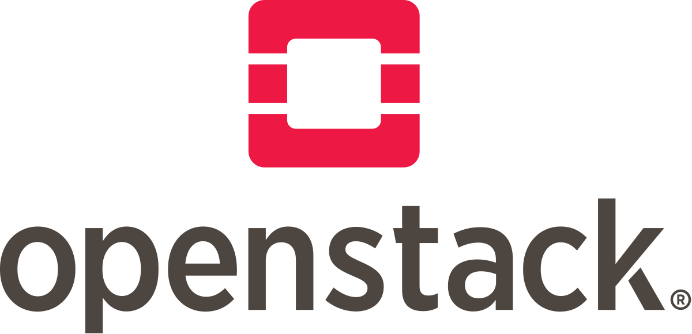
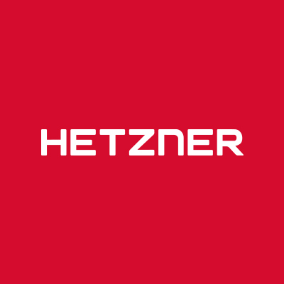
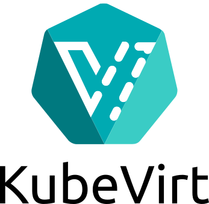
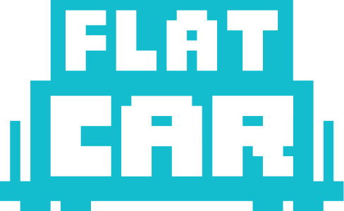

<!-- _class: cover booth-title -->
<!-- _paginate: false -->

# Flatcar Container Linux

## A secure, minimal Linux for containers

KubeCon + CloudNativeCon North America 2026

<strong>Project Pavilion, kiosk P-8A</strong> · Hall 5, Cosmic Canyon Zone

---

<!-- _class: booth centered -->

# A secure, minimal Linux for containers

- **Purpose-built for containers:** no package manager, no config drift
- **Immutable filesystem:** eliminates entire classes of vulnerabilities
- **Atomic A/B updates:** reliable, always-current OS upgrades
- **Ignition provisioning:** declarative setup on first boot
- **Open and vendor-neutral:** stewarded by the CNCF

  

---

<!-- _class: lead designed -->

Flatcar Container Linux

# Designed for

  

    
01

    
Containers

    
Kubernetes or your runtime of choice

  

  

    
02

    
Infra automation

    
Declarative provisioning with Ignition

  

  

    
03

    
Security

    
Read-only, verified, automatically updated

  

---

<!-- _class: booth -->

# Runs everywhere

  
  
  
  
  
  
  
  
  
  

Plus bare metal, and many more.

---

<!-- _class: lead qrs -->
<!-- _paginate: false -->

  
  

    <h1>Come talk to us</h1>
    <h2>Scan a code to find the community, the code and the docs</h2>
  

  

Websiteflatcar.org

  

GitHubflatcar/Flatcar

  

DiscordChat with the community

  

Learning seriesGet started with Flatcar

<strong>Find us at the Project Pavilion, kiosk P-8A</strong> · Hall 5, Cosmic Canyon Zone

  <strong>Office hours</strong> · every 2nd Thu, 16:30 CEST
  <strong>Dev sync</strong> · every 4th Thu, 16:30 CEST

